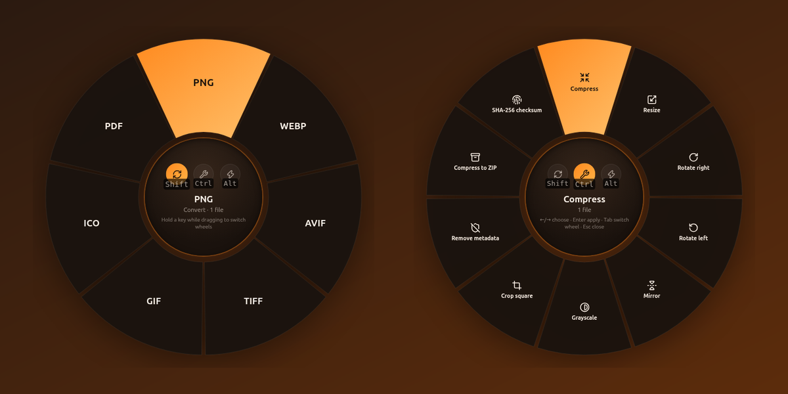

<div align="center">


# Kumquat

**Drag. Hold. Transform.**

A free, open-source and fully offline file converter for **Windows** and **Linux**.
Drop files on the floating orb, hold a key, and pick what to do from a radial wheel.

[](https://github.com/TrinsyCa/kumquat/actions/workflows/build.yml)
[](https://github.com/TrinsyCa/kumquat/releases/latest)
[](LICENSE)

[**Download**](https://github.com/TrinsyCa/kumquat/releases/latest) · [Türkçe](#türkçe)



</div>

---

Kumquat is inspired by [Tangerine for Mac](https://tangerineformac.com) and brings the same "zero-click" idea to Windows and Linux. It is an independent project and is not affiliated with Tangerine.

## Features

- **385 conversion paths** across 63 input formats: images, video, audio, PDF, documents, slides, spreadsheets, subtitles and archives
- **31 file tools**: compress, resize, rotate, crop, trim, split, merge, watermark, page numbers and more
- **8 file actions** that work on anything, folders included: send to phone (QR code), float, copy, copy path, move, copy to, terminal, show in folder
- **100% offline.** Files never leave your computer. No accounts, no uploads, no telemetry
- English and Turkish interface

## How it works

1. A small kumquat **orb** floats on your desktop (drag it anywhere).
2. Drag files from Explorer / your file manager onto the orb. The wheel opens.
3. Pick a wheel by holding a key while dragging, then drop the files on an option:

| Hold        | Wheel       | Example              |
| ----------- | ----------- | -------------------- |
| *(nothing)* | **Convert** | HEIC → JPG           |
| `Shift`     | **Convert** | MOV → MP4            |
| `Ctrl`      | **Tools**   | Compress a PDF       |
| `Alt`       | **Actions** | Send to phone        |

Keys can be changed in Settings. You can also hover the three buttons in the centre of the wheel while dragging.

### Anywhere in File Explorer and on the desktop (Windows)

You don't even need the orb. While dragging files in File Explorer or on the desktop, press `Shift`, `Ctrl` or `Alt` and the wheel opens **right under your cursor**, replacing Windows' own move / copy / create-shortcut behaviour for those keys. Drop on an option, or drop in the middle and pick with the mouse or keyboard. Right-click drags and open context menus are left alone, and the feature can be turned off in Settings.

**Without dragging:** right-click a file → *Send to → Kumquat* (Windows), *Open with → Kumquat* (Linux), press `Ctrl+Alt+K`, or click the orb → *Open files…*. Then use the keyboard: `←/→` choose, `Tab` switch wheel, `Enter` apply, `Esc` close.

## Supported formats

| Category     | Convert to                                                     | Notes                                   |
| ------------ | -------------------------------------------------------------- | --------------------------------------- |
| Images       | JPG, PNG, WebP, AVIF, TIFF, GIF, ICO, PDF                      | Also reads HEIC/HEIF, BMP, SVG          |
| Video        | MP4, MOV, MKV, WebM, GIF, MP3, M4A, WAV                        | Also reads AVI, WMV, FLV, MPG, 3GP, TS  |
| Audio        | MP3, M4A, WAV, FLAC, OGG, Opus, AIFF                           | Also reads WMA, AAC                     |
| PDF          | PNG, JPG (300 DPI, all pages), DOCX, TXT, Markdown, HTML, EPUB, XLSX, PPTX |                             |
| Documents    | PDF, DOCX, Markdown, TXT, HTML, EPUB                           | Reads DOCX, MD, TXT, RTF, HTML, EPUB (+ ODT/DOC with LibreOffice) |
| Slides       | PDF, PNG, JPG, PPTX (with LibreOffice); TXT, Markdown          | PPTX, PPT, ODP, Keynote                 |
| Spreadsheets | XLSX, ODS, CSV, TSV, PDF, HTML, JSON, Markdown                 | Reads XLS too                           |
| Subtitles    | SRT, VTT, TXT                                                  |                                         |
| Archives     | ZIP, TAR, TAR.GZ, extract                                      | Reads RAR                               |

### Tools

- **Images:** compress, resize, rotate left/right, mirror, grayscale, crop square, remove metadata (EXIF/GPS), merge into PDF
- **Video:** compress (presets + max resolution), trim, split, merge, remove audio, rotate, change speed, snapshot
- **Audio:** compress, trim, split, merge, normalize volume, change speed
- **PDF:** compress, merge (PDFs and images), split, extract pages, delete pages, rotate, page numbers, watermark
- **Documents & sheets:** merge, word count, combine into one workbook
- **Any file or folder:** compress to ZIP, SHA-256 checksum, extract archives

### Actions

- **Send to phone:** shares the files on your local network and shows a QR code. Scan it with your phone camera and the download starts. Sharing stops when you close the window.
- **Float:** pins a small window with the file on top of everything; drag it from there into any app.
- **Copy**, **Copy path**, **Move to…**, **Copy to…**, **Terminal**, **Show in folder**

## Install

Grab the latest build from [Releases](https://github.com/TrinsyCa/kumquat/releases/latest):

- **Windows 10/11 (x64):** `Kumquat-Setup-x.y.z.exe` (installer, recommended) or `Kumquat-x.y.z-win-x64.zip` (no install: unzip anywhere and run `Kumquat.exe`)
- **Linux (x64):** `Kumquat-x.y.z-x86_64.AppImage`, `.deb` (Debian/Ubuntu) or `.tar.gz`

> Builds are not code-signed yet, so Windows SmartScreen may warn on first launch (*More info → Run anyway*).
> The first time you use *Send to phone*, Windows Firewall may ask to allow Kumquat on private networks.

**Optional:** install [LibreOffice](https://www.libreoffice.org/download/) to convert PowerPoint/Keynote/ODT/DOC files and to get higher-fidelity DOCX → PDF.

## Build from source

Requires Node.js 22+.

```bash
git clone https://github.com/TrinsyCa/kumquat.git
cd kumquat
npm install
npm start          # run the app
npm test           # engine smoke test (runs every conversion on sample files)
npm run dist       # build installers for the current OS into dist/
```

`npm run test:electron` runs the same smoke test inside Electron so the HTML → PDF paths are covered too.

### Project layout

```
src/engine/     conversion engine (pure Node, no Electron): image, media, pdf, document, sheet, subtitle, archive
src/main/       Electron main process: orb window, tray, actions, settings, phone sharing
src/renderer/   orb + wheel UI, settings, share and float windows
src/shared/     translations (en, tr)
test/           smoke tests and UI drivers
```

Adding a conversion means adding an operation object to one of the engine modules — the wheel picks it up automatically. Contributions and new translations are welcome!

## Built with

[Electron](https://www.electronjs.org/) · [FFmpeg](https://ffmpeg.org/) (via ffmpeg-static) · [sharp](https://sharp.pixelplumbing.com/) · [pdf.js](https://mozilla.github.io/pdf.js/) · [pdf-lib](https://pdf-lib.js.org/) · [SheetJS](https://sheetjs.com/) · [mammoth](https://github.com/mwilliamson/mammoth.js) · [marked](https://marked.js.org/) · [Turndown](https://github.com/mixmark-io/turndown) · [PptxGenJS](https://gitbrent.github.io/PptxGenJS/) · [Lucide](https://lucide.dev/) icons

FFmpeg binaries are distributed under the GPL/LGPL by their respective authors; see `node_modules/ffmpeg-static` for details.

## License

[MIT](LICENSE) © 2026 TrinsyCa

---

## Türkçe

**Kumquat**, Windows ve Linux için ücretsiz, açık kaynaklı ve tamamen çevrimdışı çalışan bir dosya dönüştürücüdür. Mac'teki [Tangerine](https://tangerineformac.com)'den ilham alır.

- Masaüstündeki küçük **kumkat küresine** dosyaları sürükle.
- Sürüklerken bir tuşa basılı tut: tuşsuz veya `Shift` → **Dönüştür**, `Ctrl` → **Araçlar**, `Alt` → **Eylemler**.
- Dosyaları tekerlekteki seçeneğin üzerine bırak. Bu kadar.
- **Windows'ta küreye bile gerek yok:** Dosya Gezgini'nde veya masaüstünde dosya sürüklerken `Shift`, `Ctrl` veya `Alt`'a bas; Windows'un taşı/kopyala/kısayol davranışı yerine tekerlek doğrudan imlecin altında açılır. (Sağ tıkla sürükleme ve açık bağlam menüleri etkilenmez; Ayarlar'dan kapatılabilir.)

**385 dönüşüm yolu**, **31 araç** (sıkıştır, boyutlandır, kırp, böl, birleştir, filigran…) ve **8 eylem** (QR kodla telefona gönder, yüzdür, kopyala, taşı, terminalde aç…). Dosyaların asla bilgisayarından çıkmaz.

Sürüklemeden kullanmak için: dosyaya sağ tıkla → *Gönder → Kumquat* (Windows) / *Birlikte aç → Kumquat* (Linux) ya da `Ctrl+Alt+K`. Arayüz Türkçe ve İngilizce'dir; dil, Ayarlar'dan değiştirilebilir.

[En son sürümü indir →](https://github.com/TrinsyCa/kumquat/releases/latest)
